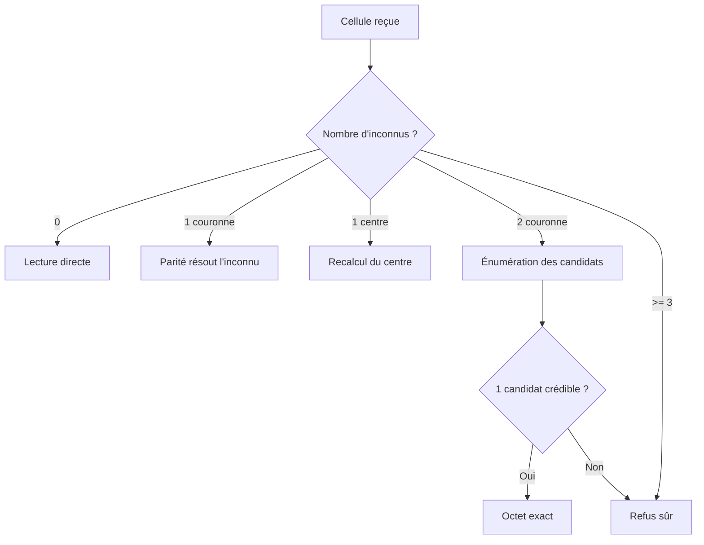
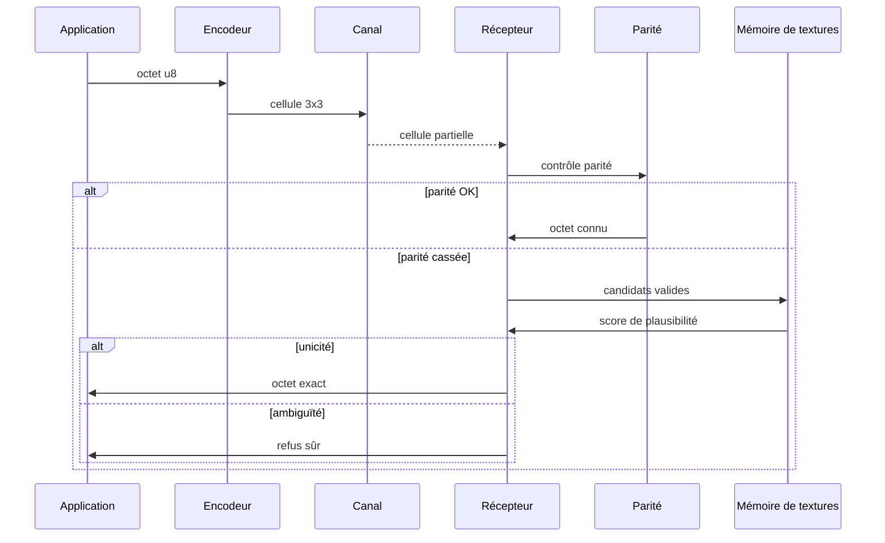

# octet-econome1.0

> Une écriture-machine spatiale, résiliente au bruit, à la perte et à la désynchronisation.

[](LICENSE)
[]()
[](https://www.rust-lang.org/)

---

## Résumé exécutif

`octet-econome1.0` est une exploration de codage binaire spatial. Au lieu d'un octet linéaire parcouru bit après bit, la donnée est portée par une cellule 3×3 : 8 bits de donnée en couronne et 1 bit de parité au centre. Le système s'appuie sur une idée simple mais forte : la redondance n'est pas seulement une forme de protection, c'est aussi une manière de rendre le signal lisible malgré les erreurs locales.

Le projet s'inscrit dans une logique de réseau bruité et de transport résilient. Une coupure, une perte de point, une légère déformation de la cellule ne doivent pas tuer l'octet. Au contraire, le système doit détecter, reconstruire ou refuser proprement, sans inventer de faux octets.

Le cœur du projet est une règle de sécurité :

- la parité détecte l'incohérence ;
- la géométrie reconstruit ce qui reste plausible ;
- la mémoire de textures filtre les candidats crédibles ;
- le refus est préférable à une fausse lecture.

C'est ainsi que le système transforme un message binaire classique en une forme résiliente, structurée comme un objet spatial, plus proche d'un code de cellule que d'un flux ASCII.

---

## Table des matières

1. [Philosophie du projet](#1-philosophie-du-projet)
2. [La cellule Bibrai](#2-la-cellule-bibrai)
3. [Encodage et décodage](#3-encodage-et-décodage)
4. [Réseau et perte de points](#4-réseau-et-perte-de-points)
5. [Reconstruction géométrique](#5-reconstruction-géométrique)
6. [Mémoire de textures](#6-mémoire-de-textures)
7. [Architecture réseau](#7-architecture-réseau)
8. [Garanties de sûreté](#8-garanties-de-sûreté)
9. [Limites et pistes](#9-limites-et-pistes)
10. [Reproductibilité](#10-reproductibilité)
11. [Conclusion](#11-conclusion)

---

## 1. Philosophie du projet

L'objectif d'`octet-econome1.0` n'est ni de créer un format de communication sur mesure pour une application spécifique, ni de promesse marketing sur la "robustesse absolue". Son ambition est plus modeste et plus solide : concevoir un objet porteur de données qui garde sa structure même quand le canal de transmission perd localement certains éléments.

Dans un réseau, le problème principal n'est pas seulement la corruption, c'est aussi la perte de synchronisation. Un flux binaire classique est linéaire : si un bit est perdu ou si le décodage est décalé, la suite entière devient ambiguë. En revanche, une cellule 3×3 est une forme compacte, auto-porteuse et localement lisible. Elle conserve une structure spatiale, donc une cohérence même quand la transmission est partiellement dégradée.

Le projet s'inscrit dans une logique d'architecture de transport :

- la donnée est portée par une forme ;
- le canal bruité perd des points ;
- le récepteur reconstitue le système à partir de contraintes ;
- si le doute persiste, le système refuse plutôt que de mentir.

Autrement dit, le format n'est pas construit pour maximiser la complétude de lecture à tout prix. Il est construit pour garantir une règle de sécurité : ne pas produire de faux octets.

---

## 2. La cellule Bibrai

Une cellule Bibrai est une grille 3×3.

- 8 points forment la couronne ;
- 1 point central porte la parité de la couronne.

```text
      d1  d2  d3
       ┌───┬───┬───┐
       │   │   │   │
   d8  │   │ P │   │  d4
       │   │   │   │
       └───┴───┴───┘
      d7  d6  d5
```

### Convention de positionnement

La couronne suit un ordre défini, sens horaire depuis le coin supérieur gauche.

```text
bit 0 -> d1
bit 1 -> d2
bit 2 -> d3
bit 3 -> d5
bit 4 -> d8
bit 5 -> d7
bit 6 -> d6
bit 7 -> d4
```

Le centre est calculé comme la parité XOR des 8 bits de la couronne.

```text
P = popcount(octet) mod 2
```

La propriété clé réside dans le fait que le centre n'est pas un élément isolé :

- il est un point de contrôle ;
- il peut être recalculé ;
- il aide à la reconstruction ;
- il permet d'identifier les cellules incohérentes.

---

## 3. Encodage et décodage

### 3.1 Encodage

Le processus d'encodage est simple :

1. placer les bits de l'octet sur la couronne ;
2. calculer la parité XOR sur 8 bits ;
3. assigner cette parité au centre.

Cette opération produit une cellule complète, valide et stable.

### 3.2 Décodage

À la réception, la cellule est d'abord évaluée sur ses contraintes :

- les points connus sont lus ;
- la couronne est contrôlée ;
- le centre de la cellule est vérifié ;
- si la parité est cassée, la cellule n'est pas triviale : elle entre dans une étape de reconstruction.

Le système distingue trois états :

- `VALID`: octet reconstruit et cohérent ;
- `REFUS`: ambiguïté ou trop grande perte ;
- `INDETERMINE`: la cellule est partiellement connue mais pas assez sûre pour livrer un octet.

Le point important de la philosophie du projet est que le système préfère l'indétermination au faux positif.

---

## 4. Réseau et perte de points

Le réseau est modélisé comme un canal qui perd un certain nombre de points au hasard. Un point perdu n'est pas forcément un bit corrompu : il peut simplement être absent, ou ne pas avoir été reçu.

Le modèle de perte peut être représenté comme suit :


Le cœur du format est qu'un point perdu ne détruit pas la structure entière. La cellule reste identifiable comme forme, même quand certains pixels sont manquants.

On mesure ensuite la capacité de récupération selon `k`, le nombre de points perdus.

---

## 5. Reconstruction géométrique

La reconstruction repose sur une logique de contraintes.

### Cas simples

- `0 point perdu`: lecture directe ;
- `1 point de la couronne perdu`: parité suffit ;
- `1 point central perdu`: le centre se recalcule ;
- `2 points perdus`: énumération des candidats valides, puis filtrage.

### Cas difficiles

- `>= 3 points perdus`: la forme est trop sous-contrainte ;
- l'algorithme refuse plutôt que de deviner.

La reconstruction suit cette logique :



Cette approche est la base des garanties de sécurité du système.

---

## 6. Mémoire de textures

La mémoire de textures (`devin.os`) ne “devine” pas. Elle ne fait qu'estimer la plausibilité d'un candidat déjà valide par la parité.

### 6.1 Les métriques

Les formes sont comparées sur plusieurs métriques simples :

- densité de la couronne ;
- symétries ;
- transitions du cycle ;
- continuité locale.

Ces métriques sont structurées pour rester robustes vis-à-vis de l'ordre des bits et des variations mineures du canal.

### 6.2 Rôle du filtre

Le filtre de texture répond à cette question :

> Parmi les candidats valides, lequel est le plus vraisemblable dans le contexte courant ?

La règle d'or est la suivante :

- la texture ne crée pas de récupération ;
- elle ne fait que filtrer ;
- si le filtrage n'a pas de résultat fiable, on refuse.

Cela empêche un phénomène très dangereux : la fausse lecture volontairement produite par le système sous l'effet d'un mauvais candidat.

---

## 7. Architecture réseau

Le dépôt contient maintenant une architecture documentée séparément dans [docs/architecture.md](docs/architecture.md). Le schéma principal est le suivant.


### 7.1 Flux d'un octet



### 7.2 Architecture fonctionnelle

```text
+-------------------------+
| Application source      |
+-----------+-------------+
            |
            v
+-----------+-------------+
| Encodeur Bibrai         |
| 8 bits -> 3x3 cellule    |
+-----------+-------------+
            |
            v
+-----------+-------------+
| Canal bruité / réseau   |
| perte locale de points   |
+-----------+-------------+
            |
            v
+-----------+-------------+
| Récepteur / parser      |
| parse la cellule        |
+-----------+-------------+
            |
      +-----+-----+
      |           |
      v           v
+-----+-----+  +-----+-----+
| Parité    |  | Géométrie |
| contrôle  |  | reconstruire |
+-----+-----+  +-----+-----+
      |                 |
      v                 v
+-------------------------------+
| Mémoire de textures / filtre  |
+-------------------------------+
      |
      v
+-------------------------------+
| Sortie : octet exact ou refus |
+-------------------------------+
```

---

## 8. Garanties de sûreté

Le projet vise des garanties fortes :

1. La détection d'erreur est garantie par la parité centrale.
2. Le centre est recalculable, donc la perte ne coûte pas forcément l'octet.
3. La cellule reste structurée même si un ou deux points sont perdus.
4. La mémoire de textures n'invente pas des octets : elle filtre.
5. En cas d'ambiguïté, on refuse plutôt que de mentir.

C'est précisément cette logique qui fait la valeur du concept. La sûreté ne dépend pas du nombre de points perdus à la fois, mais de la capacité à distinguer reconstruction crédible et reconstruction impossible.

---

## 9. Limites et pistes

Le projet est un prototype R&D, et il ne doit pas être présenté comme un système universel.

### Limites connues

- au-delà d'un certain seuil de perte, la reconstruction n'est plus fiable ;
- la mémoire de textures dépend d'une distribution observable ;
- si le contexte n'est pas bien appris, le filtre devient conservateur ;
- la sécurité exige une logique de refus, donc certains cas ne donneront pas d'octet.

### Pistes

- compression ou codage spatial plus dense ;
- optimisation de la table de texture ;
- intégration FPGA ou matériel embarqué ;
- extension à des formes 4×4 ou à des cellules hiérarchiques ;
- protocoles de synchronisation plus explicites sur la couche transport.

---

## 10. Reproductibilité

Le dépôt est pensé pour rester reproductible, avec plusieurs éléments de documentation et de visualisation :

- README de synthèse ;
- document d'architecture séparé ;
- diagrammes SVG exportés pour GitHub ;
- code Rust ou simulation associé selon le développement choisi.

Les diagrammes sont dans le dossier :

- `docs/diagrams/architecture-overview.svg`
- `docs/diagrams/network-flow.svg`
- `docs/diagrams/cell-grid.svg`

Ces fichiers sont conçus pour rester lisibles directement sur GitHub sans plugin externe.

---

## 11. Conclusion

`octet-econome1.0` ne vise pas à “remplacer le bit” par un mirage visuel. Il cherche une architecture plus honnête : une donnée portée par une forme, vérifiée par la parité, reconstruite par géométrie, et validée par un filtre probabiliste. Le résultat est un codage qui ne respecte pas seulement l'information, mais son contexte de transport.

C'est un format de recherche, une démonstration de concept et une base de réflexion sur l'encodage spatial. Il combine :

- la logique de découverte du bit ;
- la sécurité du refus ;
- la résilience de la forme ;
- la compréhension du canal.

C'est le cœur de l'idée : une donnée qui ne se perd pas simplement parce qu'un point manque, mais qui sait rester lisible tant qu'elle reste cohérente.

---

## Démarrage rapide

```bash
git clone https://github.com/tedehur/octet-econome1.0.git
cd octet-econome1.0
```

Puis ouvrir le README ou la documentation dans `docs/architecture.md`.

---

## Contact / usage

Le dépôt est un support pour un projet de recherche et de démonstration. Il est conçu pour être extensible, documenté et réutilisable dans des contextes de codage spatial, de transport robuste ou d'informatique distribuée résiliente.

