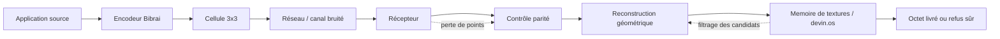
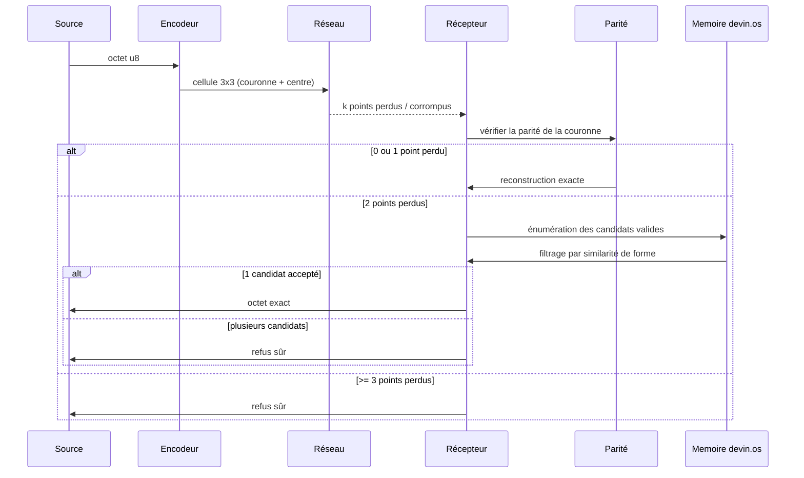
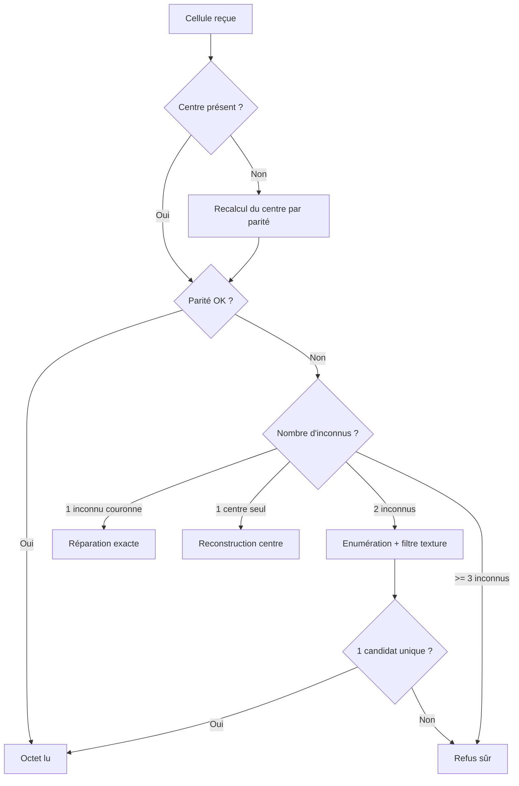

# octet-econome1.0

evolution code binaire birai

---

## 1. Vision du projet

`octet-econome1.0` explore une alternative au codage binaire linéaire : la donnée est portée par une cellule spatiale 3×3, avec les 8 bits de la couronne et un bit de parité au centre. L'idée n'est pas de remplacer le bit par un artifice visuel, mais de rendre la donnée résiliente au bruit, à la perte et à la désynchronisation du réseau.

La structure centrale est la suivante :

- source applicative émet un octet ;
- l'encodeur le transforme en cellule Bibrai ;
- le réseau perd ou dégrade certains points ;
- le récepteur reconstruit la cellule à partir de la parité et, si nécessaire, d'une mémoire de texture ;
- le résultat est un octet exact, un refus sûr, ou une cellule indéterminée.

---

## 2. Schéma réseau du livre blanc

### 2.1 Architecture logique



### 2.2 Chemin d'un octet sur le réseau



### 2.3 Schéma de décision de réception



---

## 3. Structure de la cellule Bibrai

```text
      d1  d2  d3
      ┌───┬───┬───┐
      │   │   │   │
   d8 │   │ P │   │ d4
      │   │   │   │
      └───┴───┴───┘
      d7  d6  d5
```

- `d1..d8` : 8 bits de donnée, disposés en couronne.
- `P` : bit de parité central.
- Le centre n'est pas un simple contrôle, il est aussi un point de réparation.

---

## 4. Logique réseau et sécurité

Le point clé est le suivant : la mémoire de textures ne crée pas l'information, elle ne fait que filtrer les candidats déjà valides par la parité. Ceci donne un comportement de sécurité :

- une erreur de texture ne produit pas une fausse lecture ;
- elle conduit à un refus, ou à une indétermination explicite ;
- le système privilégie la sûreté sur la complétude.

Dans le cadre d'un canal bruité, cela revient à transformer le réseau en un support où :

- la perte locale est tolérée ;
- la désynchronisation n'est plus un problème structurel ;
- l'unicité du message est reconstruite sur la forme, pas sur le flux.

---

## 5. Proposition de rôle dans le livre blanc

Le schéma réseau doit servir à montrer que le système n'est pas un simple codage d'octets, mais un protocole de transport spatial :

1. la source envoie une forme ;
2. le canal détruit des points ;
3. la réception rétablit la forme par contrainte physique et par mémoire de cohérence ;
4. la sortie est un octet sûr ou un refus sans faux positif.

Cela fixe la position de `octet-econome1.0` dans le livre blanc : un format d'encodage-machine résilient, pensé comme architecture de transport plutôt que comme simple convention de bits.

---

## 6. Prochaine étape

Le dépôt peut ensuite évoluer vers :

- `README.md` détaillé comme livre blanc ;
- `docs/architecture.md` avec les schémas réseau ;
- `docs/bibrai.md` ou `whitepaper.md` dédié à la théorie ;
- des diagrammes SVG/PNG exportés pour GitHub.

Cette première version intègre les schémas réseau directement dans le README pour que le projet soit lisible sans étape supplémentaire.

---

## 7. Références de conception

- codage spatial 3×3 ;
- bit de parité central ;
- reconstruction géométrique ;
- mémoire de textures pour sélection de candidats ;
- refus sûr en cas d'ambiguïté.

Le système vise un équilibre entre :

- tolérance à la perte ;
- protection contre les faux positifs ;
- capacité de reconstruction dans des états partiellement cassés.

